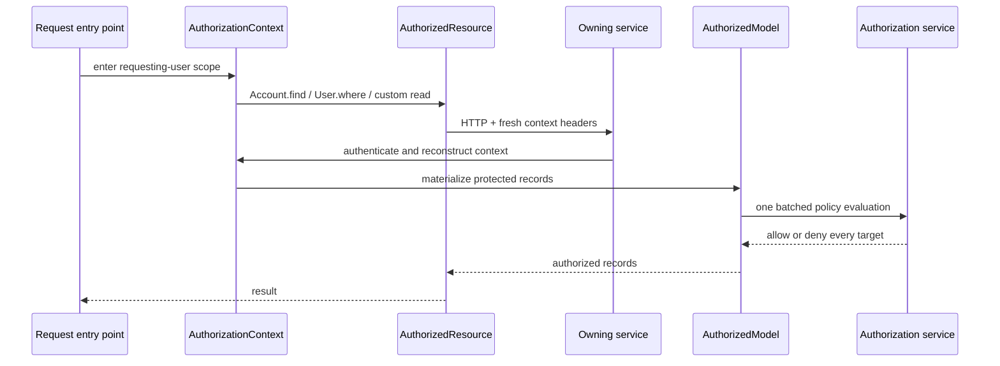

# Explicit Authorization Contexts at the Model Boundary

Series: [GraphQL Auth Explosion Case Study](/articles/series/IAM-System-Demo/iam-system-demo)

Section: Developer Affordances

The IAM demo now expresses authorization through three small abstractions with
deliberately different jobs:

- `AuthorizationContext` says **under whose authority this work is running**.
- `AuthorizedResource` carries that authority across an HTTP boundary.
- `AuthorizedModel` lets the service that owns the records decide whether the
  operation is allowed.

That distinction matters more than the base classes themselves. Propagation is
the caller's responsibility. Enforcement belongs to the service that owns the
records. The result is a model API that still feels familiar without hiding who
is responsible for each authorization decision.

This article describes the implementation at revision
[`a2522eb`](https://github.com/meleneth/iam-system-demo/tree/a2522ebe229095ff50015e9cf0017dc8286b43e8).

## The Boundary in One Picture



The remote object still feels like an ActiveResource model. That convenience no
longer means the network request can happen without an identity, and it does
not move the receiving service's policy into the caller.

## One Explicit Context

Normal user work begins inside a requesting-user context:

```ruby
AuthorizationContext.as_requesting_user(
  user_id: actor_id,
  account_id: account_id
) do
  Account.find(account_id)
end
```

Narrow internal work uses a different authority:

```ruby
AuthorizationContext.as_iam(
  identity: "IAM_SYSTEM_AUTH",
  originating_user_id: actor_id
) do
  RelationshipFact.find(...)
end
```

The distinction prevents a dangerous shortcut: a request that started as a
real user cannot quietly become `IAM_SYSTEM` just because a downstream lookup
is inconvenient. IAM scope represents authenticated service authority. The
originating user remains available for attribution, but IAM scope does not
stand in for that user's capabilities.

The context is immutable and scoped to the block. Nested scopes restore the
previous context even when the inner block raises. There is intentionally no
default identity:

```ruby
AuthorizationContext.current!
# raises AuthorizationContext::MissingContextError outside a scope
```

That failure happens before protected cache, SQL, or network access. Missing
context is therefore an explicit programming error rather than an anonymous
request that may or may not be rejected later.

Rails controllers reconstruct the context from incoming headers around the
request. IAM headers receive an additional check: the shared internal token
must authenticate them. Sending `X-IAM-Authorization-Scope: iam` by itself does
not create trusted authority.

The implementation uses `ActiveSupport::IsolatedExecutionState`, but it does
not pretend deferred work inherits the current scope. A thread, fiber, or job
must capture and re-enter it:

```ruby
captured = AuthorizationContext.capture

deferred_work do
  AuthorizationContext.with(captured) { Account.find(account_id) }
end
```

This is more ceremony than an ambient global, which is precisely the point.
The handoff is visible where execution ownership changes.

## Remote Models Propagate; They Do Not Decide

A client-side model now inherits directly from `AuthorizedResource::Base`:

```ruby
class User < AuthorizedResource::Base
  self.site = ENV.fetch("USER_SERVICE_API_BASE_URL")
  self.format = :json
end
```

Standard ActiveResource operations—including `find`, `where`, `reload`,
pagination, and mutations—require the current context. The resource builds
fresh transport headers for each operation and injects trace context. It does
not put actor metadata in ActiveResource's shared class headers or connection
state, where one concurrent request could contaminate another.

The connection is also wrapped. Code that reaches for `connection.get` or
`connection.post` cannot accidentally bypass the context check. Nonstandard
endpoints use a named wrapper so the logical operation remains visible:

```ruby
def self.search(params)
  authorized_read("search") do
    response = connection.post(
      "/users/search",
      params.to_json,
      headers.merge("Content-Type" => "application/json")
    )

    format.decode(response.body).map { |attributes| new(attributes) }
  end
end
```

A POST can still be a logical read, as it is here. Naming the operation keeps
authorization intent and telemetry tied to semantics instead of guessing from
the HTTP verb. Cache lookup belongs inside the wrapper too, so a cache hit does
not become an unprotected path.

What `AuthorizedResource` does **not** do is just as important: it makes no
client-side `/can` call and does not filter or re-authorize returned records.
The caller does not own the records, so it does not own their policy.

## Local Models Own the Decision

Inside each data service, the conventional base class now inherits from
`AuthorizedModel::Base`:

```ruby
class ApplicationRecord < AuthorizedModel::Base
  primary_abstract_class
end
```

Concrete models declare their policy next to the data whose scope gives that
policy meaning:

```ruby
class User < ApplicationRecord
  requires_read_capability "account.users.read",
    scope_type: "Account",
    target: :account_id,
    iam: %w[IAM_SYSTEM]

  allows_iam_modify "IAM_SYSTEM"
end
```

`target: :account_id` says that a User record is authorized against its owning
Account. It is not proof supplied by the client. The receiving service first
authenticates the propagated context, loads the records it owns, resolves their
actual targets, and evaluates its own policy.

The mechanism is uniform across services; the declarations retain the rules of
each domain:

| Owned record | Capability and authorization target |
| --- | --- |
| Account | `account.read` on that Account |
| User | `account.users.read` on the User's owning Account |
| Group | Either `group.read` on that exact Group or `account.users.read` on its owning Account |
| Group membership | Either exact Group authority or Account authority resolved through the membership's Group |
| Organization | `organization.read` on that Organization |
| Organization membership | Either `organization.read.accounts` on the Organization or `account.read` on the member Account |
| MSP-managed organization | `account.read` on the MSP/provider Account |
| Capability grant | Authenticated `IAM_SYSTEM` access only |

The current demo likewise reserves model mutations for authenticated
`IAM_SYSTEM` work. Repeated capability requirements are alternatives, which is
why a Group may be visible through exact Group authority or through authority
over its owning Account.

These are the domain-specific parts of the design: which capability is needed,
which scope type it applies to, which record field identifies that scope, and
which internal identities are allowed. Context propagation, batching, failure
handling, and telemetry remain identical around those declarations.

Collection materialization preserves the set-shaped work developed throughout
this case study. Targets are deduplicated, grouped by scope type and required
capability, and sent to authorization service in batches. Every returned record
must satisfy at least one declared requirement. The result is all-or-nothing;
the abstraction does not silently trim a collection to whatever happened to
pass.

The same boundary protects more than `find`:

- relation materialization and associations
- `pluck`, `ids`, existence checks, and other aggregates
- custom queries with explicit authorization targets
- creates against their requested container
- updates against both their old and new targets
- deletes against the existing target

Every concrete server model must declare a read policy and either a mutation
policy or `read_only!`. An absent policy fails closed as a configuration error.
Protected `load_async` is rejected because these services do not yet propagate
the context through Active Record's executor.

## Telemetry Follows Responsibility

Each remote logical operation emits one span such as:

```text
authorized_resource.User.search
```

Automatic HTTP instrumentation owns the child HTTP span. The wrapper records a
bounded resource type, service host, logical operation, collection size when
available, and outcome; it does not attach actor IDs, scope IDs, credentials,
or payloads.

Only the receiving-side `AuthorizedModel` emits
`authorized_resource.authorize`. Its child request to authorization service
shows where policy was actually evaluated. The trace therefore mirrors the
responsibility boundary instead of reporting the same decision twice.

Failures remain distinguishable as well. Missing context, policy denial,
authorization-service transport failure, and remote-resource transport failure
are different outcomes. That distinction is valuable when a `403`, timeout, or
empty response would otherwise flatten several unrelated problems into “the
request failed.”

## Less Code in Every Service

The shared abstractions removed authorization mechanics from the code that
implements the application. Comparing the six services immediately before the
shared context work with revision `a2522eb`, their `app/` trees changed by
**1,007 deleted lines and 482 added lines: 525 fewer lines of service-level
code**.

| Application layer | Added | Removed | Net change |
| --- | ---: | ---: | ---: |
| Models | 190 | 578 | -388 |
| Controllers | 236 | 371 | -135 |
| GraphQL | 36 | 55 | -19 |
| Workers | 20 | 3 | +17 |
| **All six `app/` trees** | **482** | **1,007** | **-525** |

Those numbers exclude specs, documentation, lockfiles, reports, and generated
artifacts. They also do not pretend the behavior disappeared. It moved into the
two shared gems, whose runtime code and gem specifications added 956 lines.
That central code covers context lifecycle, transport safety, policy
evaluation, batching, failure types, and telemetry once instead of making six
services implement partial variations of them.

The largest reduction is in models because remote resources now mostly declare
their transport while local models declare policy. Controllers no longer need
to repeat record-by-record authorization machinery, and several proxy models
and controller actions disappeared entirely. The application code that remains
describes the system's domain rather than the plumbing around every protected
operation.

## What the Abstractions Buy

The immediate win is less repeated controller and model plumbing. The more
important gain is that the system now has answers to questions that were
previously conventions:

- Can protected work begin without an actor? No.
- Can a caller declare itself to be IAM? Not without the internal credential.
- Can identity leak through shared ActiveResource headers? Context headers are
  created per operation instead.
- Does the calling service own downstream policy? No; it propagates authority.
- Can an owning model forget to declare policy? It fails closed.
- Can a collection fall back to one permission request per record? The model
  evaluator batches its distinct targets.
- Does asynchronous work inherit authority by accident? It must explicitly
  capture and re-enter the context.

The abstractions do not make authorization invisible. They make its boundaries
boring and inspectable. That is the useful kind of convenience in a distributed
system: fewer places to improvise, with the important decisions still made by
the component that owns them.

## Verification and Limits

The boundary passed the shared client/server specs, affected service
regression suites, live cross-service authorization checks, batching tests, and
a real Puma/ActiveResource trace-propagation test. Eleven production trace
scenarios completed successfully, including the wide organization response of
251 Accounts, 5,020 Users, 502 Groups, and 5,271 memberships.

The production API still intentionally disables resource creation, update, and
deletion routes. Mutation context propagation and model callbacks are covered
by boundary tests, but this demo has not added public write endpoints merely to
claim an end-to-end mutation scenario.

The source details live in the fixed-revision
[`authorization-context`](https://github.com/meleneth/iam-system-demo/tree/a2522ebe229095ff50015e9cf0017dc8286b43e8/authorization-context)
and
[`authorized-resource`](https://github.com/meleneth/iam-system-demo/tree/a2522ebe229095ff50015e9cf0017dc8286b43e8/authorized-resource)
gems. The [trace gallery](./graphql-auth-explosion-traces) shows the resulting
request boundaries in complete workloads.

Back to: [Developer Affordances](/articles/series/IAM-System-Demo/iam-system-demo#developer-affordances)
