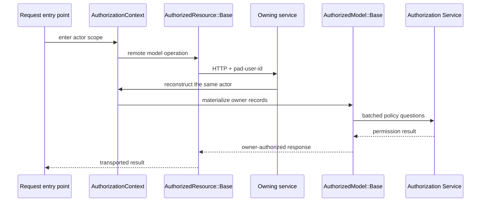

# Explicit Authorization Contexts at the Model Boundary

Series: [GraphQL Auth Explosion Case Study](/articles/series/IAM-System-Demo/iam-system-demo)

Section: Developer Affordances

The IAM demo expresses authorization through three abstractions with different jobs:

- `AuthorizationContext` says which actor the work is running as.
- `AuthorizedResource::Base` propagates that actor across HTTP.
- `AuthorizedModel::Base` lets the service that owns protected records enforce their policy.

Propagation is the caller's responsibility. Enforcement belongs to the owner. Authorization Service evaluates the requested permissions using the applicable Group grants, memberships, physical ancestry, and MSP relationships.

## The Boundary in One Picture



`AuthorizedResource` does not call `/can` on returned records and does not filter them. It requires a context, forwards the selected actor, wraps custom endpoints, and transports the response. The receiving service remains the authoritative enforcement boundary.

## One Actor, Not a Proof Bag

A normal request enters a real-actor context:

```ruby
AuthorizationContext.as_requesting_user(user_id: actor_id) do
  Account.find(account_id)
end
```

Narrow internal fact retrieval enters an explicit reserved context:

```ruby
AuthorizationContext.as_iam(identity: "IAM_SYSTEM_AUTH") do
  RelationshipFact.find(...)
end
```

The immutable context contains one `actor_id`. It does not accumulate Account IDs, permissions, decisions, or authorization proofs as it crosses the application. Nested blocks restore the previous context, and protected work outside a context raises `AuthorizationContext::MissingContextError` before its HTTP, SQL, or cache operation.

Deferred work must capture and re-enter the context:

```ruby
captured = AuthorizationContext.capture
deferred_work { AuthorizationContext.with(captured) { Account.find(account_id) } }
```

The three actor forms are intentionally distinct:

| Actor | Meaning |
| --- | --- |
| Real User ID | The request is evaluated through the actor's Group memberships and grants. |
| `IAM_SYSTEM` | An allowlisted internal IAM read that is not permission checked. |
| `IAM_SYSTEM_AUTH` | A narrow relationship-fact lookup used while Authorization Service evaluates a real actor. |

A real actor never acquires ambient authority by being converted into either reserved value. Authorization Service may gather facts through `IAM_SYSTEM_AUTH`, but the resulting decision is still about the original real actor. These values are routing markers in the demo, not authenticated workload identities.

## Remote Models Propagate

Cross-service clients inherit from `AuthorizedResource::Base`:

```ruby
class User < AuthorizedResource::Base
  self.site = ENV.fetch("USER_SERVICE_API_BASE_URL")
  self.format = :json
end
```

Standard ActiveResource reads, reloads, associations, pagination, and mutations require the current context. Fresh headers and trace metadata are derived for each operation rather than stored in shared class headers or pooled connection state.

Named custom endpoints use the same boundary:

```ruby
def self.search(params)
  authorized_read("search") do
    response = connection.post(
      "/users/search",
      params.to_json,
      headers.merge("Content-Type" => "application/json")
    )
    format.decode(response.body).map { |attributes| new(attributes) }
  end
end
```

`POST` is a transport choice here; the logical operation is a read. Wrapping the operation ensures context propagation and makes its trace label describe the resource operation rather than guess from the HTTP verb.

## Owning Models Enforce One Read Policy

Each persistence model inherits from `AuthorizedModel::Base` and declares one authoritative read policy. One policy may contain a legitimate OR, as `OrganizationAccount` does:

```ruby
class OrganizationAccount < ApplicationRecord
  requires_read_any_capability(
    { capability: "organization.read.accounts", scope_type: "Organization", target: :organization_id },
    { capability: "account.read", scope_type: "Account", target: :account_id },
    iam: %w[IAM_SYSTEM]
  )
end
```

The alternatives are evaluated per relationship row. A collection succeeds only when every row satisfies at least one branch. The precise decision response stays correlated by scope type, scope ID, and permission; no Organization allow is reused as an Account allow.

Other model policies retain their domain meaning:

| Protected record | Authoritative read question |
| --- | --- |
| Account | `account.read` on that Account |
| User | `account.users.read` on the User's owning Account |
| Group | `group.read` on that exact Group |
| Group membership | `group.read` on its referenced Group |
| Organization | `organization.read` on that Organization |
| OrganizationAccount | `organization.read.accounts` on its Organization OR `account.read` on its Account, per row |

For the Group question, Authorization Service recognizes an exact `group.read` grant and `account.users.read` covering the Group's actual owning Account. A grant applies only through explicit membership in the Group that owns the grant; grant applicability is not inferred from the Group's owning Account.

Relation materialization, `pluck`, `ids`, existence checks, aggregates with explicit targets, and model mutations all pass through owner-side protection. Targets are deduplicated and evaluated in bounded batches. An undeclared policy fails closed. Protected `load_async` is rejected because the demo does not implicitly propagate context through Active Record's executor.

## Telemetry Follows Responsibility

Remote operations emit spans such as `authorized_resource.User.search`. Only owner-side `AuthorizedModel` emits `authorized_resource.authorize`, with the authorization request beneath it. That distinction makes transport failures, missing context, policy denial, and Authorization Service failures visible as different outcomes.

The abstractions keep the important work explicit: callers carry one actor, owners derive policy targets from their own records, and Authorization Service answers the specific permission questions. They do not authenticate the reserved headers, provide complete cache invalidation, or turn a downstream response into a reusable authorization proof.

The focused context, transport, evaluator, decision-correlation, service request, and cross-service boundary specs cover these contracts. End-to-end performance and complete security claims require broader evidence than those tests provide.

Related: [Extracting Cross-Service Models into Shared Gems](./dev-affordances-cross-service-resource-gems)
