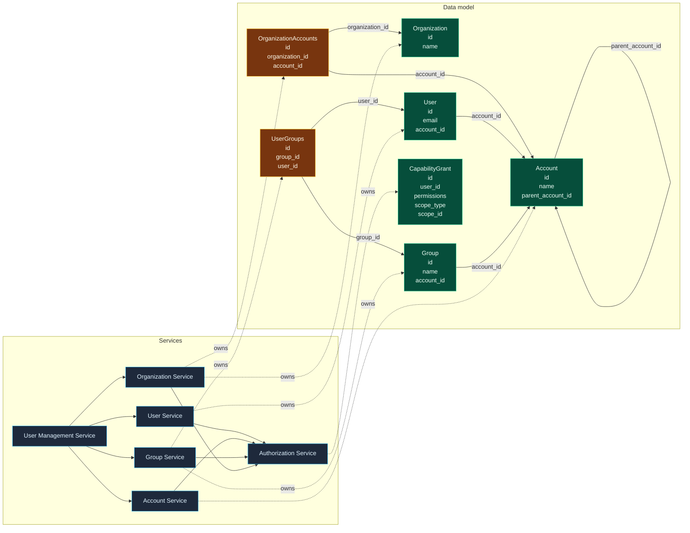
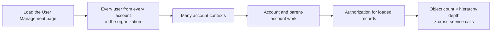
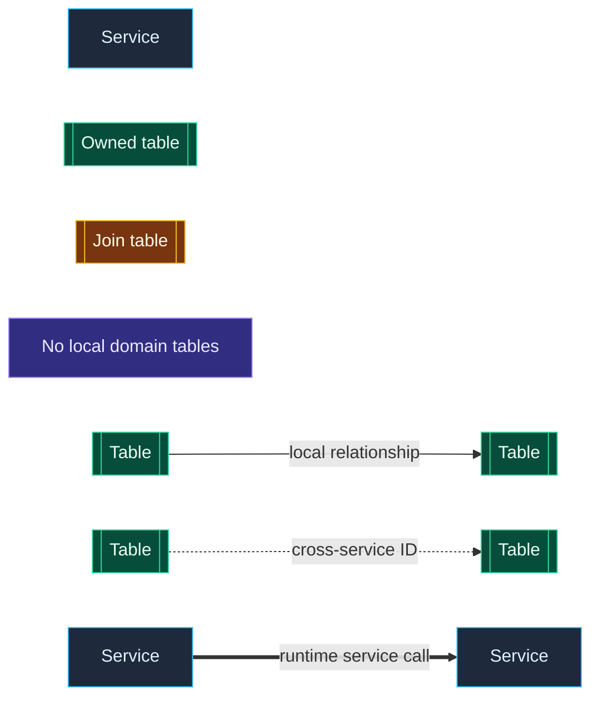
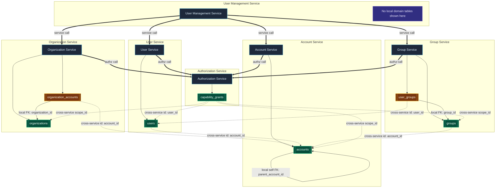
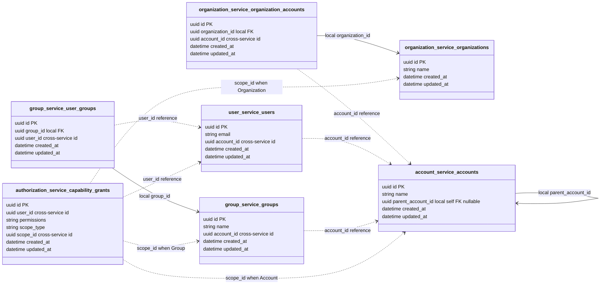

# GraphQL Auth Explosion Case Study: Overview

Series: [GraphQL Auth Explosion Case Study](/articles/series/IAM-System-Demo/iam-system-demo)

> Status: Draft

LLM Disclaimer:
LLM's were used in the preperation of this series of articles.  For the most part I try to call out per-article if it is particularly LLM heavy, but for the most part I'm trying to keep it human-written and avoid triggering people.

## Meet My Straw Men

This is my distributed authorization system. There may or may not be similarities to authorization systems I have worked with before, details will differ but I wanted to talk about distributed system optimization and this is as good of a reason as any.

We start with Organization, owned by OrganizationService. Organizations have names, and multiple accounts. Organization service knows which Accounts belong to which Organization.

Account service owns Accounts. Accounts have a name. Accounts also have a parent_account_id. An account without a parent_account_id is a top level account for the Organization.

User service owns Users. A User stores an `account_id`, an email address, and other profile details. The `account_id` refers to an Account owned by Account service; User service does not own the Account record.

Group service owns Groups and UserGroup membership records. A Group stores the `account_id` it belongs to, and a UserGroup stores the `user_id` and `group_id` that connect a User to a Group. Group service owns those relationships; User service does not store Groups on the User record.

Authorization service owns CapabilityGrants. A CapabilityGrant identifies a user, a permission, and the scope where the permission was granted. Authorization service exposes the `can` API used to ask whether a user may perform a specific action against a specific scope. User service does not store CapabilityGrants on the User record.

We also have UserManagementService, which the user will send web requests to directly. We also eventually support GraphQL on this service.

A tricky bit about this authorization system comes from the account hierarchy as defined by parent_account_id. If you have the capability grant anywhere in an account in your direct line of parent_account_id, you have the capability in the child account. This is useful for things like making sure the Admin for the Organization has full control for every account in the Organization.

## How the System Works

To set the stage for our code links, we are taking some shortcuts in the code base. We expect a pad-user-id header to be set for API calls, which marks the user id the request is being made on behalf of. This is a datacenter only header, you cannot pass it in from outside. If the header is sent with a value of IAM_SYSTEM, then authorization checks are omitted as the request is assumed to be internal to the IAM system itself. In a production environment, there would be a requirement that the IAM_SYSTEM requests would be signed with an IAM private key to verify origin.

We use ActiveResource heavily in this implementation, to make remote objects feel like 'just another rails model'.

An account-scoped record cannot be loaded from a service unless the requesting user has an explicit grant on the record's owning account or on an account in that account's direct lineage.

Direct lineage means one path through the account tree: start with the owning account, follow `parent_account_id` to its parent, and continue until reaching the top-level account. It includes the owning account and its ancestors. It does not include children, sibling branches, cousins, or every other account in the organization. A grant flows down that path from an ancestor to its descendants; it does not flow upward or sideways.

## Be Wildly Allergic to N+1

N+1 is not only a database-query problem. In a distributed system, an innocent
object accessor can hide a network request. That request can trigger its own
database work, hierarchy traversal, and authorization calls before returning.
Code that looks like a small loop can therefore multiply work across several
services.

User Management is where that multiplication becomes unavoidable. The page
loads every user belonging to every account in an organization. Each user
belongs to an account, each account may have a chain of parents, and every
service must verify that the requested records are authorized. One page load
therefore crosses many account contexts at once.

The original parent traversal made this especially stark: following
`account.parent` was a cross-network call, not an in-process association or a
local database query. Repeating that traversal while loading and authorizing a
large result is an N+1 visible from space. Once the reconstruction implemented
authorization for all of those record loads, the request reproduced the known
failure mode: it took minutes and could not respond before timeout.

The broad advice is simpler than any implementation in the rest of this
series: treat one-record-at-a-time work inside a collection as a defect until
you have proved it is bounded. Be even more suspicious when the work crosses a
service boundary.

## How to Read the Numbered Parts

The numbered parts follow the order in which the problem was actually solved.
They are not a claim that CTEs, Redis, Dataloader, async requests, or Falcon are
the point of the exercise. Each was used to remove or contain one multiplier in
the same request.

The reconstruction was also developed in that order. Some obvious retrieval
and hierarchy problems had to be fixed before every service had implemented
the complete authorization behavior. When that authorization was finished, the
remaining multipliers combined and the intended failure reproduced exactly.
That history is slightly messy, but it is more useful than pretending the full
problem appeared fully formed and was solved from a clean plan.

For each part, keep four questions in view:

1. What one-record-at-a-time behavior existed?
2. What caused it to multiply?
3. Which boundary did this change remove or contain?
4. What expensive shape still remained afterward?

The implementation details are evidence. The transferable lesson is to expose
request cardinality, preserve batching across every layer, and refuse to let
local-looking code conceal unbounded remote work.

## Service/Table View

The diagram above is the relationship map. This is the same information in a table-shaped format, split two ways: first by which service owns which tables, then by the fields that make the joins and service hops work.

### Diagram Key

### Tables Per Service

### Fields Per Table

### Organization Service Hops

Organization Service is the awkward example because it owns the organization-to-account membership table, but it does not own Account rows. A lookup can move through both kinds of relationships:

```mermaid
flowchart LR
  classDef service fill:#1e293b,stroke:#38bdf8,color:#e0f2fe
  classDef table fill:#064e3b,stroke:#34d399,color:#ecfdf5
  classDef join fill:#78350f,stroke:#fbbf24,color:#fffbeb

  Request[Request for organization accounts]
  OrganizationService[Organization Service]
  Organizations[[organizations]]
  OrganizationAccounts[[organization_accounts]]
  AccountService[Account Service]
  Accounts[[accounts]]
  AuthorizationService[Authorization Service]

  Request == service call ==> OrganizationService
  OrganizationService == authz call ==> AuthorizationService
  OrganizationService -->|local read| Organizations
  Organizations -->|local FK: id to organization_id| OrganizationAccounts
  OrganizationAccounts -. account_id list .-> AccountService
  AccountService -->|local read| Accounts

  class OrganizationService,AccountService,AuthorizationService service
  class Organizations,Accounts table
  class OrganizationAccounts join
```

The important distinction is that Organization Service can locally answer, "which account ids are attached to this organization?" It still has to call Account Service when it needs Account records, because `organization_accounts.account_id` is an identifier crossing a service boundary, not a local foreign key into an accounts table.

## Case Study Spine

This is the historical order in which the multipliers were found and removed,
not a ranked list of technologies or a recommended universal stack.

1. [Part 1: CTE](/articles/series/IAM-System-Demo/graphql-auth-explosion-part-1-cte)
2. [Part 2: Multiple Object Retrieval](/articles/series/IAM-System-Demo/graphql-auth-explosion-part-2-multiple-object-retrieval)
3. [Part 3: Multiple Object Authorization](/articles/series/IAM-System-Demo/graphql-auth-explosion-part-3-multiple-object-authorization)
4. [Part 4: Redis Cache, per service](/articles/series/IAM-System-Demo/graphql-auth-explosion-part-4-redis-cache-per-service)
5. [Part 5: Smart APIs](/articles/series/IAM-System-Demo/graphql-auth-explosion-part-5-smart-apis)
6. [Part 6: Async MADNESS](/articles/series/IAM-System-Demo/graphql-auth-explosion-part-6-async-madness)
7. [Part 7: GraphQL and Dataloader](/articles/series/IAM-System-Demo/graphql-auth-explosion-part-7-graphql-and-dataloader)
8. [Part 8: Falcon](/articles/series/IAM-System-Demo/graphql-auth-explosion-part-8-falcon)
9. [Conclusion: Architecture Is Throughput](/articles/series/IAM-System-Demo/graphql-auth-explosion-conclusion)
10. [Project Timeline](/articles/series/IAM-System-Demo/graphql-auth-explosion-project-timeline)

This case study sits alongside the [Developer Affordances](/articles/series/IAM-System-Demo/iam-system-demo#developer-affordances) notes, where the scaffold, ActiveResource layer, data generation, devcontainer, and Foreman setup explain how the demo became possible to build and inspect.

## Developer Affordances

- [How I Scaffolded an Entire Distributed Platform in 10 Minutes](/articles/series/IAM-System-Demo/dev-affordances-distributed-platform-in-10-minutes)
- [ActiveResource and the Default Implementation that Astounded Me](/articles/series/IAM-System-Demo/dev-affordances-activeresource-default-implementation)
- [Creating a Million Users](/articles/series/IAM-System-Demo/dev-affordances-creating-a-million-users)
- [Devcontainers for Local Distributed Systems](/articles/series/IAM-System-Demo/devcontainers-for-local-distributed-systems)
- [Foreman for Local Process Orchestration](/articles/series/IAM-System-Demo/foreman-for-local-process-orchestration)
