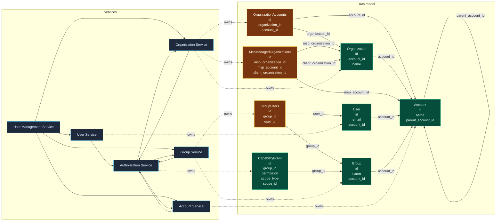
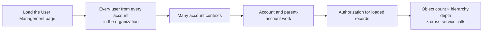
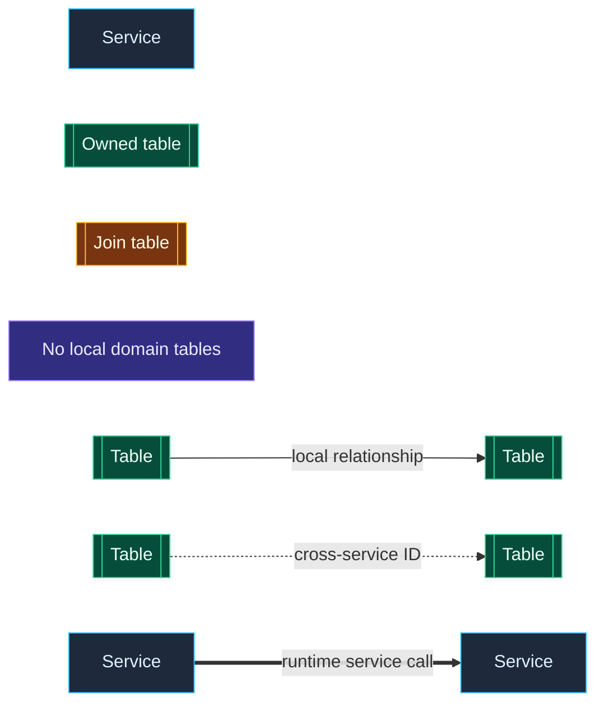
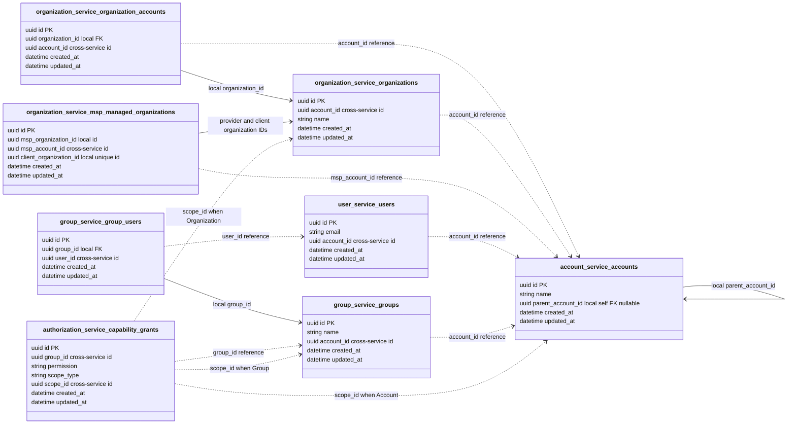
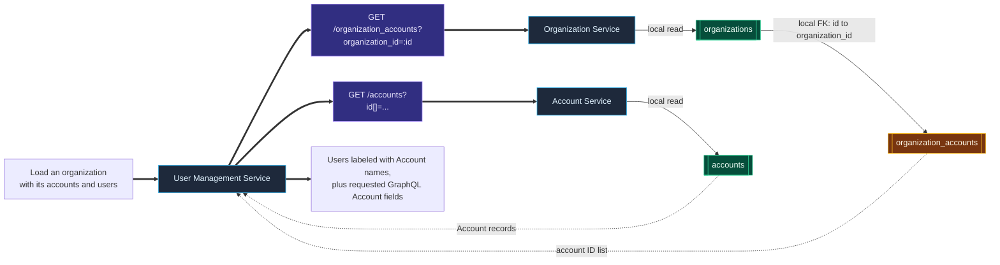

# GraphQL Auth Explosion Case Study: Overview

Series: [GraphQL Auth Explosion Case Study](/articles/series/IAM-System-Demo/iam-system-demo)

## The Workload

This is a distributed authorization system built to make cross-service request cardinality visible. Ordinary site requests operate in one Account context. Organization-wide and MSP user management assemble Users, Groups, memberships, and Accounts across many contexts. That second workload is where local-looking model traversal becomes nested HTTP, repeated hierarchy work, and repeated authorization.

We start with Organization, owned by OrganizationService. Organizations have names, and multiple accounts. Organization service knows which Accounts belong to which Organization.

Account service owns Accounts. Accounts have a name. Accounts also have a parent_account_id. An account without a parent_account_id is a top level account for the Organization.

User service owns Users. A User stores an `account_id`, an email address, and other profile details. The `account_id` refers to an Account owned by Account service; User service does not own the Account record.

Group service owns Groups and GroupUser membership records. A Group stores the `account_id` it belongs to, and a GroupUser stores the `user_id` and `group_id` that connect a User to a Group. Group service owns those relationships; User service does not store Groups on the User record.

Authorization service owns CapabilityGrants. A CapabilityGrant identifies a **Group**, a permission, and the Account, Group, or Organization scope where that permission was granted. Users receive grants through Group memberships; Authorization Service asks Group Service for the requesting actor's Group IDs before evaluating matching grants. It exposes the `/can` API used to ask whether that actor may perform a specific action against a specific scope.

User Management Service is the application-facing composition layer. It exposes GraphQL and assembles responses from the five owning services.

A tricky bit about this authorization system comes from the account hierarchy as defined by `parent_account_id`. If one of your Groups has a capability grant on an Account in the target's direct ancestor line, you have that capability on the descendant Account. MSP provider relationships add authorization-only edges between account trees without changing the physical parent hierarchy.

## How the System Works

The demo expects a `pad-user-id` header on protected API calls. For ordinary work it contains the actor's User ID. `IAM_SYSTEM` marks allowlisted internal reads, while `IAM_SYSTEM_AUTH` is limited to the relationship lookups Authorization Service needs from Group and Organization services. These values are routing markers in this test system, not authenticated service identities. A production design would need a real workload-identity mechanism rather than trusting a header value.

We use ActiveResource heavily in this implementation, to make remote objects feel like 'just another rails model'.

An account-scoped record cannot be loaded from a service unless one of the requesting actor's Groups has the required grant on the record's owning Account, on a physical ancestor, or on an explicitly linked MSP provider scope.

Direct lineage means one path through the account tree: start with the owning account, follow `parent_account_id` to its parent, and continue until reaching the top-level account. It includes the owning account and its ancestors. It does not include children, sibling branches, cousins, or every other account in the organization. A grant flows down that path from an ancestor to its descendants; it does not flow upward or sideways.

## Be Wildly Allergic to N+1

N+1 is not only a database-query problem. In a distributed system, an innocent
object accessor can hide a network request. That request can trigger its own
database work, hierarchy traversal, and authorization calls before returning.
Code that looks like a small loop can therefore multiply work across several
services.

User Management is where that multiplication becomes unavoidable. The page
loads every user belonging to every account in an organization. Each user
belongs to an account, each account may have a chain of parents, and every
service must verify that the requested records are authorized. One page load
therefore crosses many account contexts at once.

The illustrative per-record parent traversal makes this especially stark: following
`account.parent` was a cross-network call, not an in-process association or a
local database query. Repeating that traversal while loading and authorizing a
large result is an N+1 visible from space. The supported implementation keeps
that traversal in Account Service and exposes batched retrieval to callers.

The broad advice is simpler than any implementation in the rest of this
series: treat one-record-at-a-time work inside a collection as a defect until
you have proved it is bounded. Be even more suspicious when the work crosses a
service boundary.

## How to Read the Numbered Parts

The numbered parts follow the dependency between the mechanisms. Recursive SQL
keeps a hierarchy walk in its owning database. Collection APIs make remote
retrieval batch shaped. That batching exposes an authorization request that is
still too broad, so `/can` asks for the specific decision the owner needs.
Owner-aligned caches and domain APIs preserve the shape, and GraphQL Dataloader
assembles the application response without returning to record loops.

For each part, keep four questions in view:

1. What one-record-at-a-time behavior existed?
2. What caused it to multiply?
3. Which boundary did this change remove or contain?
4. What expensive shape still remained afterward?

The implementation details are evidence. The transferable lesson is to expose
request cardinality, preserve batching across every layer, and refuse to let
local-looking code conceal unbounded remote work.

## Service/Table View

The diagram above is the relationship map. This is the same information in a table-shaped format, split two ways: first by which service owns which tables, then by the fields that make the joins and service hops work.

### Diagram Key

### Tables Per Service

```mermaid
flowchart TB
  classDef service fill:#1e293b,stroke:#38bdf8,color:#e0f2fe
  classDef table fill:#064e3b,stroke:#34d399,color:#ecfdf5
  classDef join fill:#78350f,stroke:#fbbf24,color:#fffbeb
  classDef external fill:#312e81,stroke:#a78bfa,color:#ede9fe

  subgraph UMS[User Management Service]
    UserManagementService[User Management Service]
    UserManagementTables[No local domain tables shown here]
  end

  subgraph ORG[Organization Service]
    OrganizationService[Organization Service]
    Organizations[[organizations]]
    OrganizationAccounts[[organization_accounts]]
    MspManagedOrganizations[[msp_managed_organizations]]
  end

  subgraph ACCT[Account Service]
    AccountService[Account Service]
    Accounts[[accounts]]
  end

  subgraph USER[User Service]
    UserService[User Service]
    Users[[users]]
  end

  subgraph GROUP[Group Service]
    GroupService[Group Service]
    Groups[[groups]]
    GroupUsers[[group_users]]
  end

  subgraph AUTHZ[Authorization Service]
    AuthorizationService[Authorization Service]
    CapabilityGrants[[capability_grants]]
  end

  OrganizationService --> Organizations
  OrganizationService --> OrganizationAccounts
  OrganizationService --> MspManagedOrganizations
  AccountService --> Accounts
  UserService --> Users
  GroupService --> Groups
  GroupService --> GroupUsers
  AuthorizationService --> CapabilityGrants

  OrganizationAccounts -->|local FK: organization_id| Organizations
  MspManagedOrganizations -->|local IDs: provider and client organizations| Organizations
  Accounts -->|local self FK: parent_account_id| Accounts
  GroupUsers -->|local FK: group_id| Groups

  OrganizationAccounts -. cross-service id: account_id .-> Accounts
  Organizations -. cross-service id: account_id .-> Accounts
  MspManagedOrganizations -. cross-service id: msp_account_id .-> Accounts
  Users -. cross-service id: account_id .-> Accounts
  Groups -. cross-service id: account_id .-> Accounts
  GroupUsers -. cross-service id: user_id .-> Users
  CapabilityGrants -. cross-service id: group_id .-> Groups
  CapabilityGrants -. cross-service scope_id .-> Accounts
  CapabilityGrants -. cross-service scope_id .-> Organizations
  CapabilityGrants -. cross-service scope_id .-> Groups

  UserManagementService == service call ==> UserService
  UserManagementService == service call ==> OrganizationService
  UserManagementService == service call ==> AccountService
  UserManagementService == service call ==> GroupService

  UserService == authz call ==> AuthorizationService
  AccountService == authz call ==> AuthorizationService
  GroupService == authz call ==> AuthorizationService
  OrganizationService == authz call ==> AuthorizationService
  AuthorizationService == relationship facts ==> GroupService
  AuthorizationService == hierarchy facts ==> AccountService
  AuthorizationService == provider facts ==> OrganizationService

  class UserManagementService,OrganizationService,AccountService,UserService,GroupService,AuthorizationService service
  class Organizations,Accounts,Users,Groups,CapabilityGrants table
  class OrganizationAccounts,MspManagedOrganizations,GroupUsers join
  class UserManagementTables external
```

### Fields Per Table

### From Organization Membership to Account Records

Organization Service does not need full Account records to answer which
accounts belong to an organization. It owns `organization_accounts`, so it can
answer that question with account IDs.

User Management needs more than those IDs for its composite UI. The
organization-wide User Management screen labels and filters users by Account
name, while each User record contains only an `account_id`. Its GraphQL
`Organization.accounts` field can also return Account fields such as `name` and
`parent_account_id`. User Management therefore asks Organization Service for
membership, then uses those IDs to request the current Account records from
Account Service:

The important distinction is that `organization_accounts.account_id` is enough
to establish membership, but it is not an Account record and it is not a local
foreign key into an accounts table. The caller that needs Account fields must
cross the Account Service boundary. In this path, that caller is User
Management—not Organization Service. Account Service remains the owner and
source of truth for those fields; User Management is composing records for a
screen and GraphQL response, not taking ownership of them.

## Case Study Spine

This is the order in which the mechanisms depend on one another, not a ranked
list of technologies or a recommended universal stack.

1. [Part 1: Recursive SQL](/articles/series/IAM-System-Demo/graphql-auth-explosion-part-1-cte)
2. [Part 2: Multiple Object Retrieval](/articles/series/IAM-System-Demo/graphql-auth-explosion-part-2-multiple-object-retrieval)
3. [Part 3: Multiple Object Authorization](/articles/series/IAM-System-Demo/graphql-auth-explosion-part-3-multiple-object-authorization)
4. [Part 4: Redis Cache, per Service](/articles/series/IAM-System-Demo/graphql-auth-explosion-part-4-redis-cache-per-service)
5. [Part 5: Smart APIs](/articles/series/IAM-System-Demo/graphql-auth-explosion-part-5-smart-apis)
6. [Part 6: GraphQL and Dataloader](/articles/series/IAM-System-Demo/graphql-auth-explosion-part-6-graphql-and-dataloader)
7. [Conclusion: Architecture Is Throughput](/articles/series/IAM-System-Demo/graphql-auth-explosion-conclusion)
8. [Future Explorations](/articles/series/IAM-System-Demo/graphql-auth-explosion-future-explorations)

This case study sits alongside the [Developer Affordances](/articles/series/IAM-System-Demo/iam-system-demo#developer-affordances) notes, where the scaffold, ActiveResource layer, data generation, devcontainer, and Foreman setup explain how the demo became possible to build and inspect.

## Developer Affordances

- [How I Scaffolded an Entire Distributed Platform in 10 Minutes](/articles/series/IAM-System-Demo/dev-affordances-distributed-platform-in-10-minutes)
- [ActiveResource and the Default Implementation that Astounded Me](/articles/series/IAM-System-Demo/dev-affordances-activeresource-default-implementation)
- [Explicit Authorization Contexts at the Model Boundary](/articles/series/IAM-System-Demo/dev-affordances-explicit-authorization-boundaries)
- [Extracting Cross-Service Models into Shared Gems](/articles/series/IAM-System-Demo/dev-affordances-cross-service-resource-gems)
- [Creating a Million Users](/articles/series/IAM-System-Demo/dev-affordances-creating-a-million-users)
- [Devcontainers for Local Distributed Systems](/articles/series/IAM-System-Demo/devcontainers-for-local-distributed-systems)
- [Foreman for Local Process Orchestration](/articles/series/IAM-System-Demo/foreman-for-local-process-orchestration)

The current implementation and focused tests establish the request shapes and
authorization semantics described here. Performance numbers require a fresh
run against the same implementation; the series therefore limits current
claims to mechanisms and bounded work.
