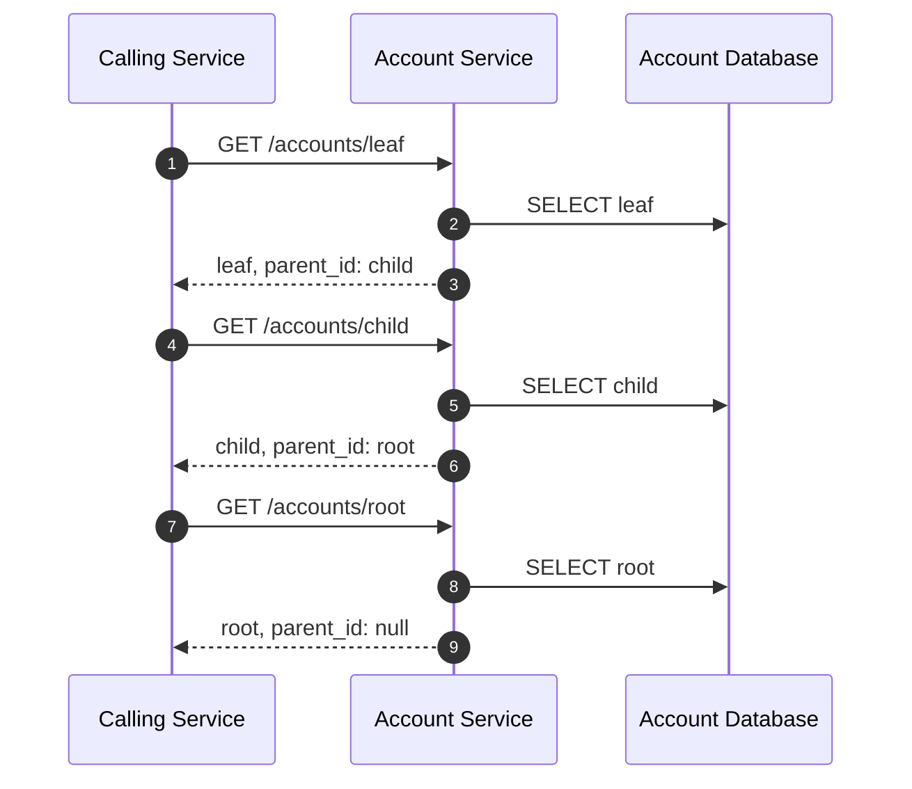
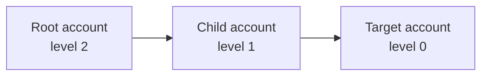

# GraphQL Auth Explosion Case Study, Part 1: CTE

Series: [GraphQL Auth Explosion Case Study](/articles/series/IAM-System-Demo/iam-system-demo)  
Overview: [GraphQL Auth Explosion Case Study](/articles/series/IAM-System-Demo/graphql-auth-explosion-case-study)

> Status: ramblings

## CTE

An Account stores only its immediate `parent_account_id`. To authorize a record owned by a deeply nested account, the system needs the complete direct lineage from that account to its top-level ancestor.

The straightforward application-level implementation repeatedly loads the next parent:

```ruby
accounts = [Account.find(target_account_id)]

while accounts.last.parent_account_id
  accounts << Account.find(accounts.last.parent_account_id)
end
```

That loop looks harmless when `Account` looks like a local model. Here it is an ActiveResource model, so every `find` is another request across the network to Account Service. A lineage containing five accounts requires five service calls and five separate database lookups before authorization can use the result.



A recursive common table expression moves that traversal into the database. This simplified query shows the shape used by the demo:

```sql
WITH RECURSIVE account_ancestry(id, parent_account_id, name, level) AS (
  SELECT id, parent_account_id, name, 0
  FROM accounts
  WHERE id = :target_account_id

  UNION ALL

  SELECT parent.id,
         parent.parent_account_id,
         parent.name,
         child.level + 1
  FROM accounts parent
  INNER JOIN account_ancestry child
    ON parent.id = child.parent_account_id
  WHERE parent.id = ANY(:organization_account_ids)
)

SELECT id, parent_account_id, name, level
FROM account_ancestry
ORDER BY level DESC;
```

The first `SELECT` is the anchor. It starts with the account whose lineage was requested and labels it level zero.

The second `SELECT` is the recursive step. It joins the current row's `parent_account_id` to the parent account's `id`, adds that parent to the result, and repeats. Recursion stops when the current account has no parent.

The `organization_account_ids` condition is a boundary check. Organization Service owns the fact that an account belongs to an organization. Account Service uses that known account-ID set to prevent a malformed or cross-organization parent reference from carrying the traversal outside the target organization.

Finally, `ORDER BY level DESC` returns the lineage from the top-level account down to the target:



The caller now makes one request for the hierarchy, and Account Service resolves the direct lineage with one recursive database query. The response contains the target and its ancestors—not the target's children, its sibling branches, or every account in the organization.

The production implementation accepts multiple target accounts, constructs bound UUID inputs, integrates organization scoping, and groups each returned lineage back under its requested account ID. Those mechanics support the later batching work, but the recursion is the same anchor-and-parent step shown above.

[View the fixed-revision `compute_accounts_with_parents` implementation](https://github.com/meleneth/iam-system-demo/blob/55dec87ecebf97632cfb36f259bf71d4b5e36a21/account-service/app/controllers/accounts_controller.rb#L190-L250)

## Measured Evidence

Compare the [measured hierarchy results](./graphql-auth-explosion-results#hierarchy-traversal-and-smart-apis) with the [depth-5 parent traversal and CTE traces](./graphql-auth-explosion-traces#follow-parents-or-ask-for-the-hierarchy).
