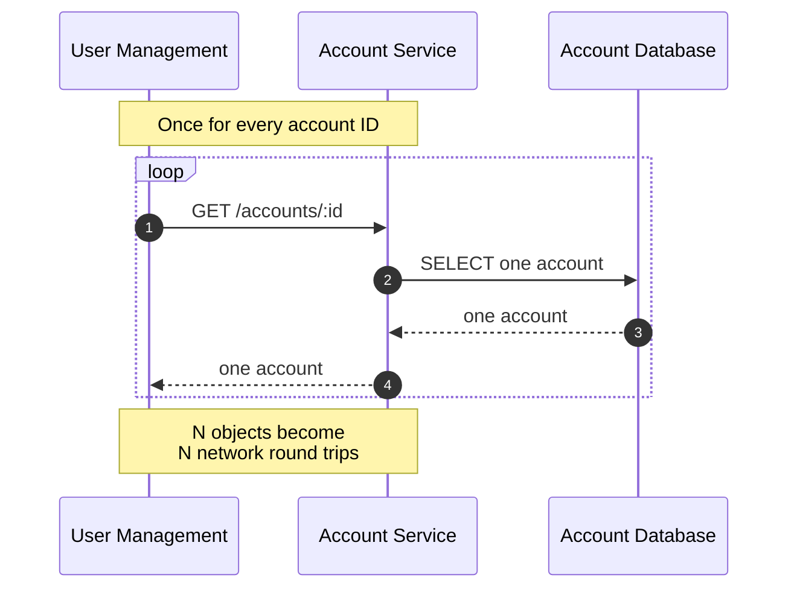
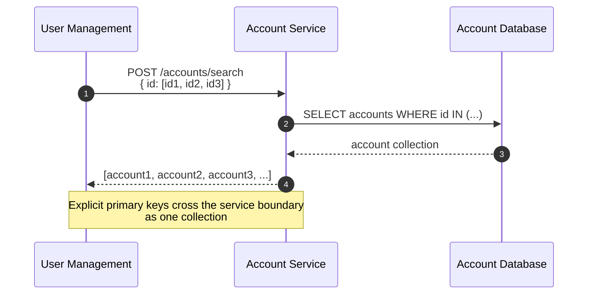
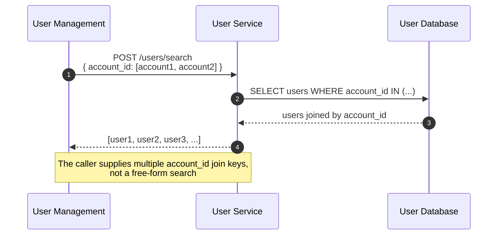

# GraphQL Auth Explosion Case Study, Part 2: Multiple Object Retrieval

Series: [GraphQL Auth Explosion Case Study](/articles/series/IAM-System-Demo/iam-system-demo)

Overview: [GraphQL Auth Explosion Case Study](/articles/series/IAM-System-Demo/graphql-auth-explosion-case-study)

> Status: draft; retrieval-mode benchmark collected September 17, 2026.

The [measured retrieval results](./graphql-auth-explosion-results#retrieval-and-authorization) now compare serial and batched modes with the same fixture, authorization mode, and cache state.

| Deep fixture, capabilities mode, Redis disabled | Median seconds [minimum–maximum] | Outcome |
| --- | ---: | --- |
| Serial retrieval | 23.673 [21.907–25.449] | 3/3 succeeded |
| Batched retrieval | 2.076 [2.050–2.366] | 3/3 succeeded |

The ratio of medians is 11.4×. Wide serial retrieval hit the 180-second client deadline in all three runs; wide batched retrieval returned three empty HTTP replies. Neither provides a completed wide-fixture latency comparison. These retrieval traces are too large for the hosted gallery; the [eight-target hierarchy pair](./graphql-auth-explosion-traces#eight-hierarchy-calls-or-one-batch) illustrates batching at a different boundary.

## Multiple Object Retrieval

When fetching a large number of objects from a remote service, one at a time is a latency death sentence. We can provide an array of IDs and reduce request latency overall. The current resource clients use configurable chunks: `IAM_DEMO_BATCH_SIZE` defaults to 1,000 and accepts values from 1 through 10,000. OpenTelemetry traces keep each resulting HTTP request and owning-service query visible.

### One Object Per Request

### Multiple Primary Keys in One Request

### Multiple Records Through Multiple Join Keys

