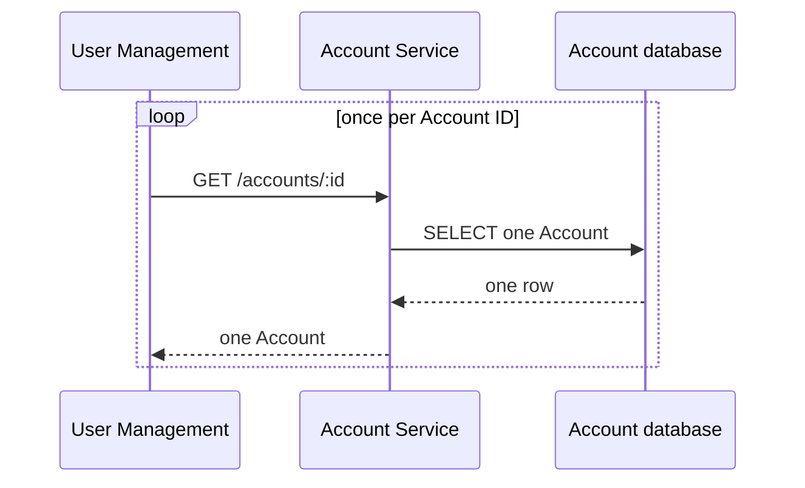
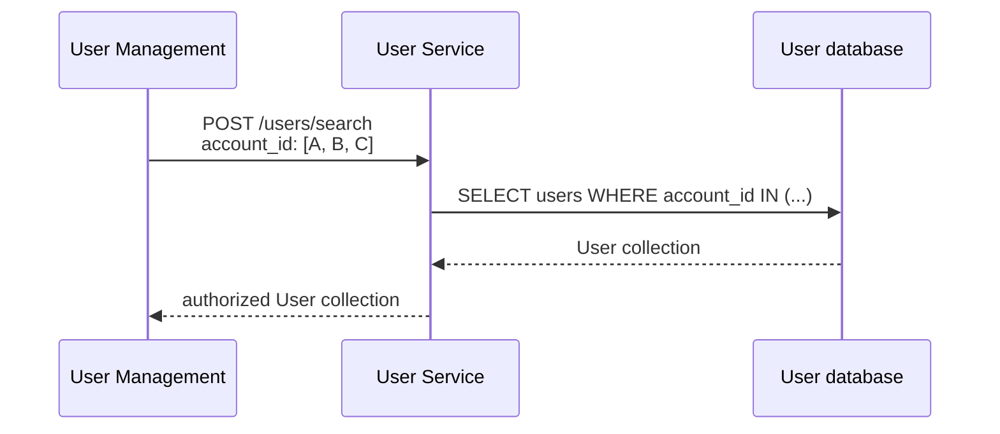

# GraphQL Auth Explosion Case Study, Part 2: Multiple Object Retrieval

Series: [GraphQL Auth Explosion Case Study](/articles/series/IAM-System-Demo/iam-system-demo)

Overview: [GraphQL Auth Explosion Case Study](/articles/series/IAM-System-Demo/graphql-auth-explosion-case-study)

## Turn Record Loops into Collection Requests

The problematic path starts one record at a time. A remote model makes this easy to miss: `find` looks like local Ruby even when it performs an HTTP request, triggers policy evaluation, walks a hierarchy, and queries another database.



The remedy begins at the transport boundary. The current clients expose searches that carry several primary keys or join keys in one request:

```http
POST /accounts/search
{"id":["account-a","account-b"]}

POST /users/search
{"account_id":["account-a","account-b"]}

POST /group_users/search
{"user_id":["user-a","user-b"]}
```

The owning service performs a set-oriented query and authorizes the returned collection. The clients split larger inputs into `IAM_DEMO_BATCH_SIZE` chunks; the configured default is 1,000 and accepted values range from 1 through 10,000.



## Batch Shape Has to Survive the Whole Call Path

A collection endpoint is only useful if the layers underneath it retain the same shape. The resource client must not loop over IDs. The controller must not turn a set query back into `find` calls. The policy layer must derive distinct targets from the collection and authorize them in batches. Related lookups must accept their own collection keys.

The clients also have to reconstruct the result the caller asked for. `Account.with_parents_batch_ordered`, for example, deduplicates the request sent over the wire and then restores the original root order. Missing or ambiguous hierarchy results become empty entries instead of shifting another Account's lineage into the wrong position. Dataloader sources similarly regroup flat User or membership responses under the key that requested them.

This work reduces remote request and materialization cardinality. It does not, by itself, establish a latency improvement; that requires a current measurement. More importantly, it does not solve authorization merely because fewer HTTP calls exist.

## The Next Multiplier Becomes Visible

Once retrieval crosses the boundary as a collection, the policy layer can see a large set of Account scopes at once. Fetching a complete capability list for every one of those scopes is still an oversized question when the owning service needs only one permission.

Retrieval did not “lose its batch shape.” It began per record, then became batch shaped. That improvement exposed the next problem: authorization also had to preserve the batch while asking a narrower question.

Next: [Multiple Object Authorization](./graphql-auth-explosion-part-3-multiple-object-authorization)
