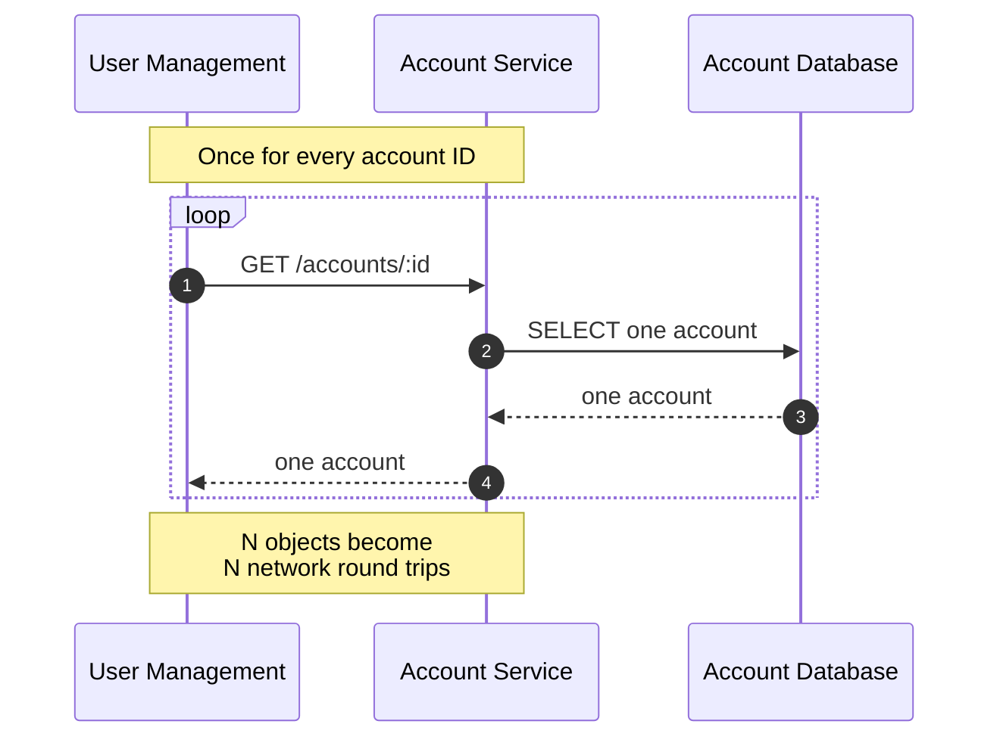
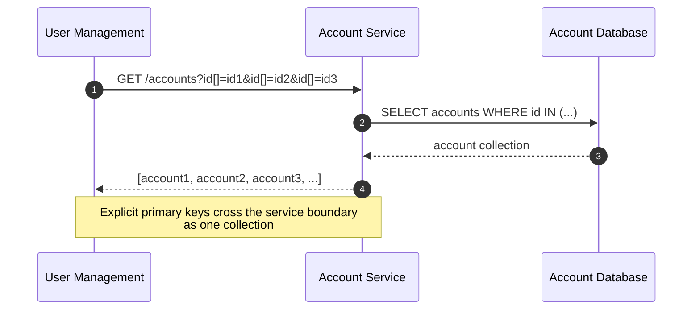
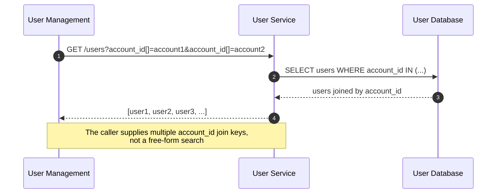

# GraphQL Auth Explosion Case Study, Part 2: Multiple Object Retrieval

Series: [GraphQL Auth Explosion Case Study](/articles/series/IAM-System-Demo/iam-system-demo)  
Overview: [GraphQL Auth Explosion Case Study](/articles/series/IAM-System-Demo/graphql-auth-explosion-case-study)

> Status: waiting on reproducible retrieval-mode benchmark
>
> Publication work is intentionally paused pending the experiment described in
> `TODO_FOR_ARTICLE.md` in the `iam-system-demo` repository. The full-organization
> User Management workload needs a runtime switch between serial, one-object-at-a-time
> retrieval and batched collection retrieval so this article can compare the same
> endpoint, fixture, authorization mode, and cache state.

## Multiple Object Retrieval

When fetching a large number of objects from a remote service, one at a time is a latency death sentence. We can provide an array of id's to be fetched, and reduce request latency overall. We started by implementing this at the REST request level, to get timings of improvements from OpenTelemetry in the Jaeger interface for viewing spans. It turns out, we can load up to 500 of these by providing an array of UUIDs with current system configuration.

### One Object Per Request

### Multiple Primary Keys in One Request

### Multiple Records Through Multiple Join Keys

Previous: [Part 1: CTE](/articles/series/IAM-System-Demo/graphql-auth-explosion-part-1-cte)  
Next: [Part 3: Multiple Object Authorization](/articles/series/IAM-System-Demo/graphql-auth-explosion-part-3-multiple-object-authorization)
