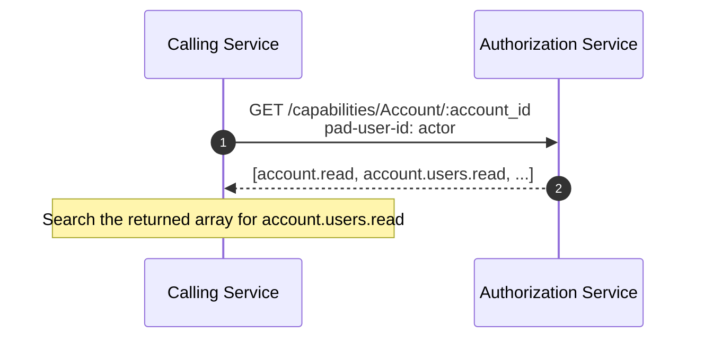
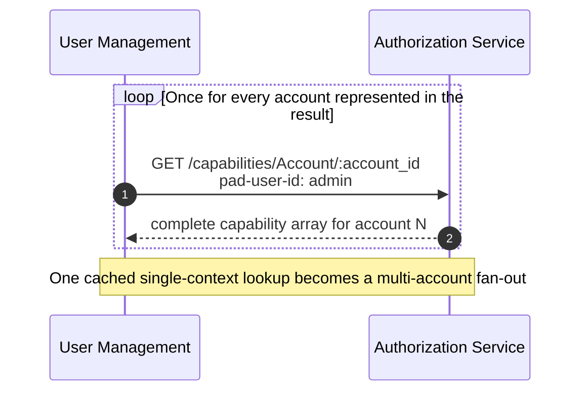
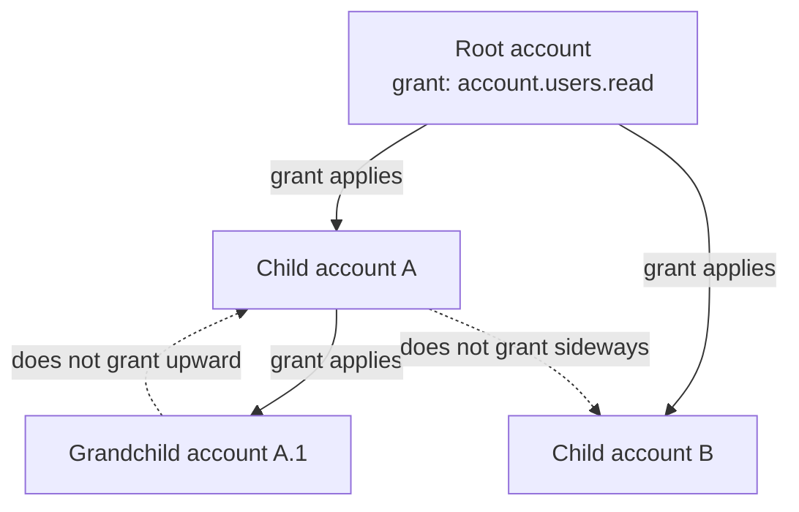
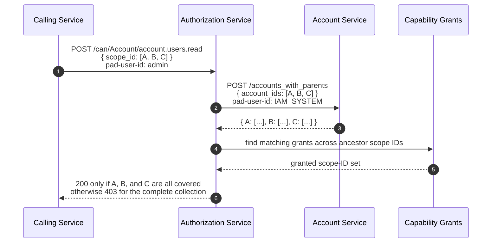

# GraphQL Auth Explosion Case Study, Part 3: Multiple Object Authorization

Series: [GraphQL Auth Explosion Case Study](/articles/series/IAM-System-Demo/iam-system-demo)  
Overview: [GraphQL Auth Explosion Case Study](/articles/series/IAM-System-Demo/graphql-auth-explosion-case-study)

> Status: waiting on authorization implementation audit
>
> Publication work is intentionally paused pending the Part 3 audit in
> `TODO_FOR_ARTICLE.md` in the `iam-system-demo` repository. The current set-based
> multi-account authorization path must be checked against the intended downward-only
> inheritance and all-or-nothing collection semantics before it is presented as
> the finished solution.

## Multiple Object Authorization

Object retrieval fans out to Authorization checks. At each service level, an array of objects is being requested, and the entire request should fail if Authorization is missing for any of those objects. In our example system, Authorization is cumulative per parent account - if you have permission to the parent account, you have permission to the child account. The Authorization service supports a 'can' endpoint, to check if a given user has a specific permission for a type of object.

These are individual level grants, not a collection of all the grants a user has. They are cached in redis, and are checkable in a single pipelined redis call.

### The Single-Context Capability Shape

That response is bounded when a normal product request operates inside one account context. Organization-wide User Management changes the cardinality:

### Authority Flows Down the Account Tree

For a target account, only that account and its direct ancestor chain are relevant. A grant does not flow upward from a child or sideways into a sibling branch.

### Ask One Question About the Whole Set

The account IDs come from relationship queries, not an arbitrary list supplied by the user. The authorization call verifies the complete result as an invariant. It does not silently filter the collection down to whatever happens to pass.

Previous: [Part 2: Multiple Object Retrieval](/articles/series/IAM-System-Demo/graphql-auth-explosion-part-2-multiple-object-retrieval)  
Next: [Part 4: Redis Cache, per service](/articles/series/IAM-System-Demo/graphql-auth-explosion-part-4-redis-cache-per-service)
