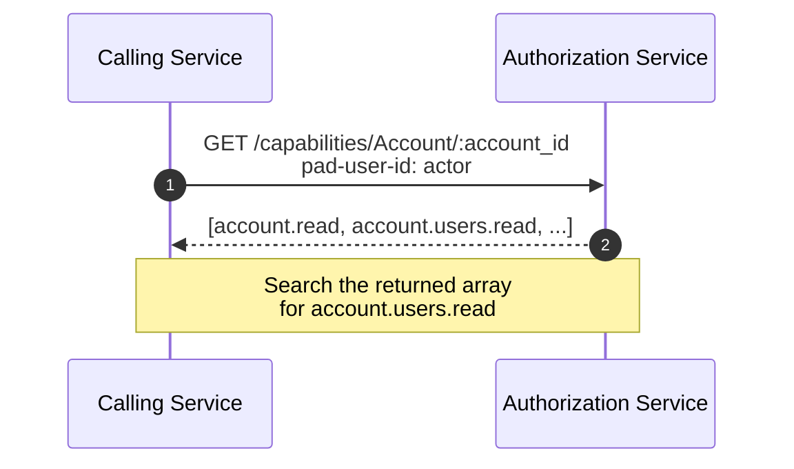
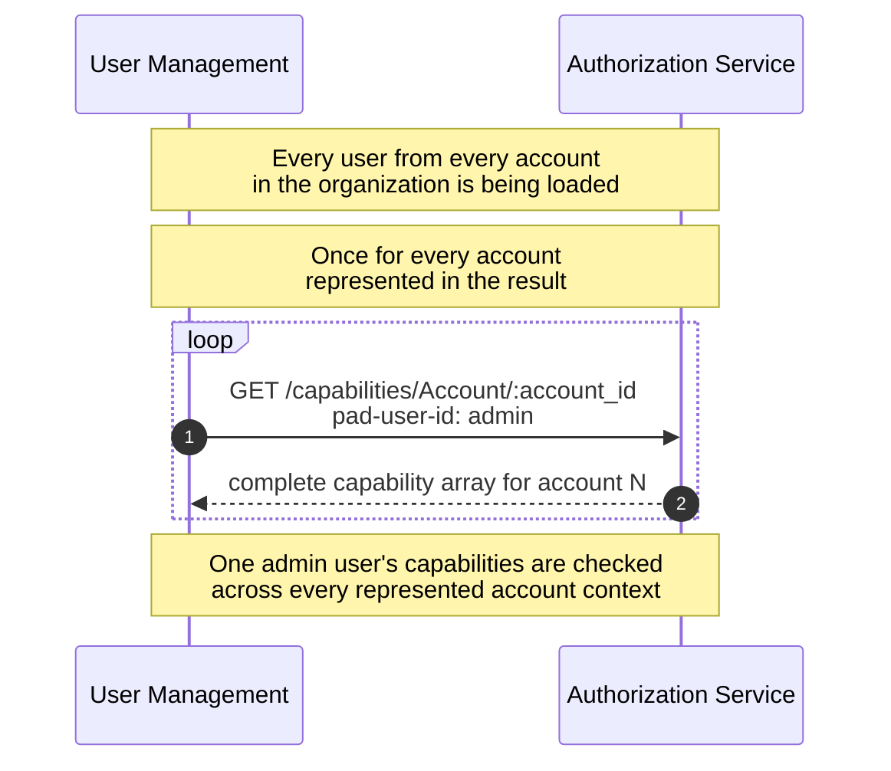
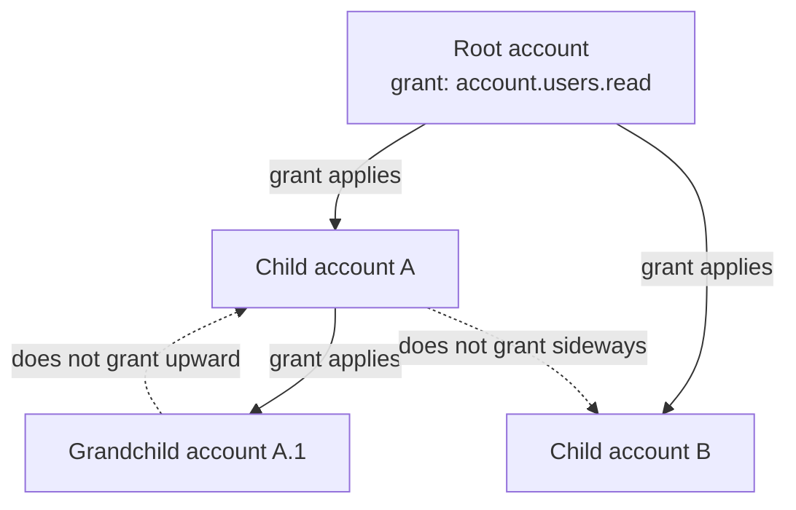
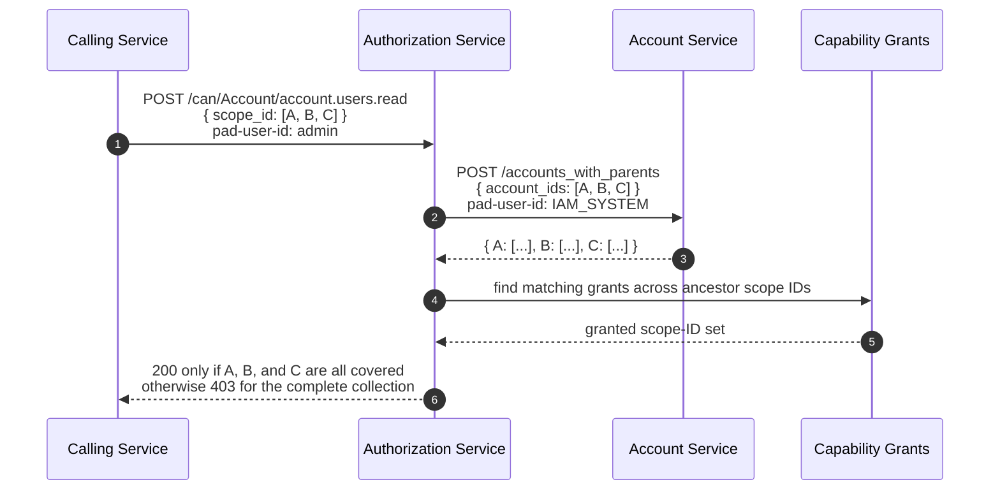

# GraphQL Auth Explosion Case Study, Part 3: Multiple Object Authorization

Series: [GraphQL Auth Explosion Case Study](/articles/series/IAM-System-Demo/iam-system-demo)  
Overview: [GraphQL Auth Explosion Case Study](/articles/series/IAM-System-Demo/graphql-auth-explosion-case-study)

> Status: waiting on authorization implementation audit
>
> Publication work is intentionally paused pending the Part 3 audit in
> `TODO_FOR_ARTICLE.md` in the `iam-system-demo` repository. The current set-based
> multi-account authorization path must be checked against the intended downward-only
> inheritance and all-or-nothing collection semantics before it is presented as
> the finished solution.

## Multiple Object Authorization

Object retrieval fans out to Authorization checks. At each service level, an array of objects is being requested, and the entire request should fail if Authorization is missing for any of those objects. In our example system, Authorization is cumulative per parent account - if you have permission to the parent account, you have permission to the child account. The Authorization service supports a 'can' endpoint, to check if a given user has a specific permission for a type of object.

These are individual-level grants, not a collection of all the grants a user has.

### The Single-Context Capability Shape

In a normal, non-User-Management product request, the user operates inside one
account context. The calling service asks for that user's complete capability
list for the account, then checks the returned array for the capability it
needs. Because the request concerns one user and one account, the response is
bounded:

#### Organization-Wide User Management

The User Management page loads every user belonging to every account in the
organization. Unlike a normal request, its result therefore spans the entire
account tree instead of one account context. The following diagram shows the
consequence: after loading users across all of those accounts, User Management
repeats the same capability-list lookup for every account represented by those
users.

### Authority Flows Down the Account Tree

For a target account, authorization considers that account and its direct
ancestor chain. A grant on an ancestor applies downward to its descendants. A
grant does not flow upward from a child or sideways into a sibling branch:

### Ask One Question About the Whole Set

The account IDs come from relationship queries, not an arbitrary list supplied
by the user. Authorization therefore checks the complete query result as an
invariant: every account must be covered, or the entire request fails. It does
not silently filter the collection down to whatever happens to pass.

### Memberships Need Their Owning Groups

A `GroupUser` membership has a Group ID, not the Account ID needed for an
`account.users.read` check. Group Service reads each matching Group's `id`
and `account_id` before authorizing the membership collection. It checks the
Account IDs as a set first. If that check fails, it evaluates each Group using
`group.read` or `account.users.read` on the owning Account. A missing Group
is an error, not an implicitly authorized membership.

This Group lookup is separate from Authorization Service's lookup of the
**actor's Group memberships**, which identifies applicable grants. It is also
separate from loading full Group records for the response. The [complete
wide-organization trace](./graphql-auth-explosion-traces#authorization-inside-a-complete-organization-request)
shows the first lookup as `SQL Group Pluck` under
`GroupUser.collection.authorize`.

## Measured Evidence

The [retrieval and authorization results](./graphql-auth-explosion-results#retrieval-and-authorization) distinguish successful capabilities-versus-`/can` comparisons from empty-HTTP-reply failures. These measurements do not replace the authorization semantics audit above.

### Trace the Collection Request

The gallery shows the [complete wide-organization `/can` request](./graphql-auth-explosion-traces#authorization-inside-a-complete-organization-request), including its collection authorization batches. The much larger full-capabilities request is summarized there from the archived source trace; it is not offered as a live waterfall.
