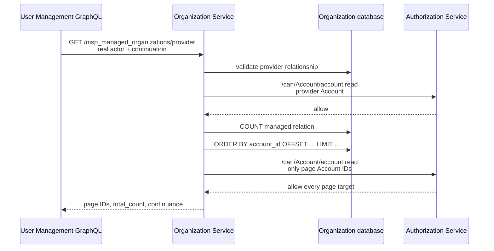

# GraphQL Auth Explosion Case Study, Part 5: Smart APIs

Series: [GraphQL Auth Explosion Case Study](/articles/series/IAM-System-Demo/iam-system-demo)

Overview: [GraphQL Auth Explosion Case Study](/articles/series/IAM-System-Demo/graphql-auth-explosion-case-study)

## Put Domain Work Behind Domain APIs

A useful service API accepts the question the caller actually has. It does not force the caller to reconstruct an owner-controlled relationship one record at a time.

The hierarchy endpoints are the simplest example:

```http
GET /account_with_parents/:account_id

POST /accounts_with_parents
{"account_ids":["account-a","account-b"]}
```

Account Service can combine its physical parent links with Organization membership scope, use its recursive CTE, cache owner-derived lineages, and return results correlated to the requested roots. The caller does not need to know how those facts are stored.

The same principle appears in filtered search endpoints and grouped count endpoints. `POST /users/search` accepts several Account join keys. `POST /groups/search` accepts several IDs. Count endpoints return grouped scalar results, but they still take explicit authorization targets because a number cannot reveal which records it summarizes.

## MSP Pages Are an Owning-Service Query

The GraphQL `mspUserManagement` field starts with this call path:

```text
mspUserManagement
  → MspManagedOrganization.page
  → GET /msp_managed_organizations/:msp_account_id
```

Although the Rails controller lives under an `Internal` module, that route is actor-facing. `MspManagedOrganization.page` forwards the real actor. The separate `/internal/msp_managed_organizations/:msp_account_id` route is the `IAM_SYSTEM`-only form.

For an actor-facing page, Organization Service:

1. validates that the provider Account belongs to the provider Organization in the managed relationship;
2. requires `account.read` on that provider Account;
3. counts the full distinct managed relationship in SQL;
4. selects a stable Account-ID page in SQL, ordered by Account ID;
5. requires `account.read` on every Account disclosed on that page; and
6. returns the page, total relationship count, and next continuation offset.

The service materializes and authorizes only the requested page. Its configured maximum is `IAM_DEMO_BATCH_SIZE`: 1,000 by default, with accepted configuration values from 1 through 10,000. One unreadable page Account rejects the entire page; rows are not silently filtered. Off-page Accounts are not submitted for Account authorization.

The `total_count` is relationship metadata disclosed after the provider relationship and provider `account.read` checks. It counts all managed Accounts, not the actor-readable subset. It does not require materializing or authorizing the whole managed set, and it does not introduce a special MSP permission.



Smart APIs do not erase service boundaries. They give the owner enough information to do set-oriented work, preserve correlations, and enforce the policy attached to the data being disclosed.

Next: [GraphQL and Dataloader](./graphql-auth-explosion-part-6-graphql-and-dataloader)
