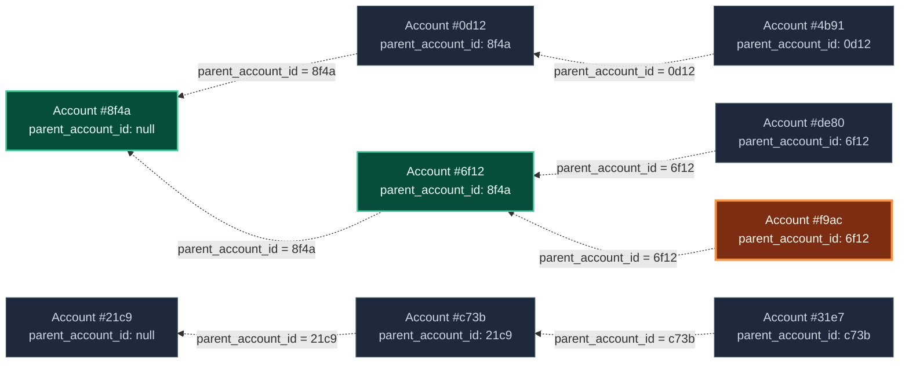

# GraphQL Auth Explosion Case Study, Part 5: Smart APIs

Series: [GraphQL Auth Explosion Case Study](/articles/series/IAM-System-Demo/iam-system-demo)

Overview: [GraphQL Auth Explosion Case Study](/articles/series/IAM-System-Demo/graphql-auth-explosion-case-study)

> Status: ramblings

## Smart APIs

The account hierarchy is a tree, but each row only knows its immediate parent through `parent_account_id`. For a deeply nested account, the useful authorization question is often: which ancestors do I need to check before I can answer `can?`?

It is very common in this system to need to get the list of parent accounts for a given account because of the way Authorization works.

In the uncached case, Account Service asks Organization Service for the Account IDs belonging to the target's Organization. Organization Service caches that membership list in its own Redis instance. Account Service feeds those IDs into the recursive CTE, returns only the target's direct physical ancestors, and caches that hierarchy in its own Redis instance.

This API deliberately does not return an MSP provider Account as another
parent. Organization Service owns explicit provider/client relationships, and
Authorization Service uses them to build a separate virtual scope graph while
evaluating Group grants. Keeping the public hierarchy physical prevents an
authorization relationship from masquerading as a data-model parent link.

## Measured Evidence

The [hierarchy and batch results](./graphql-auth-explosion-results#hierarchy-traversal-and-smart-apis) measure avoided requests. Inspect the [eight individual hierarchy GETs and one batch POST](./graphql-auth-explosion-traces#eight-hierarchy-calls-or-one-batch) as complete interactive traces.
