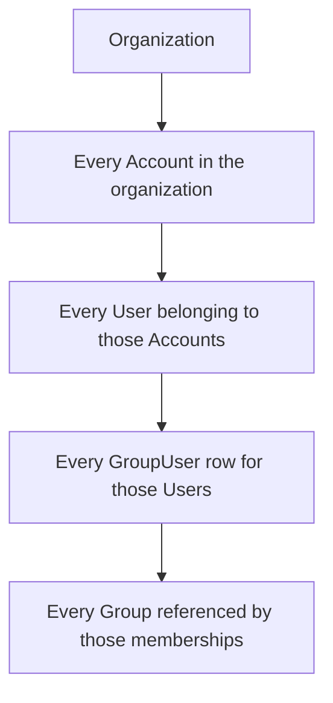
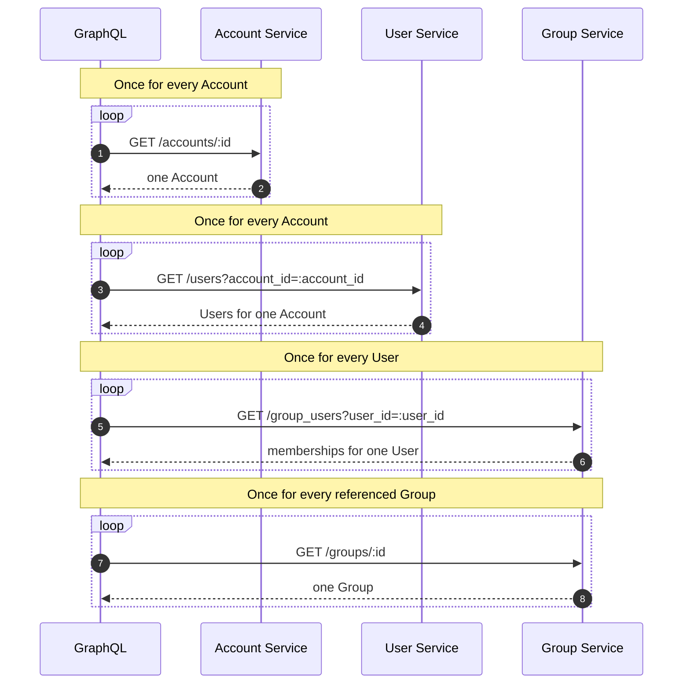
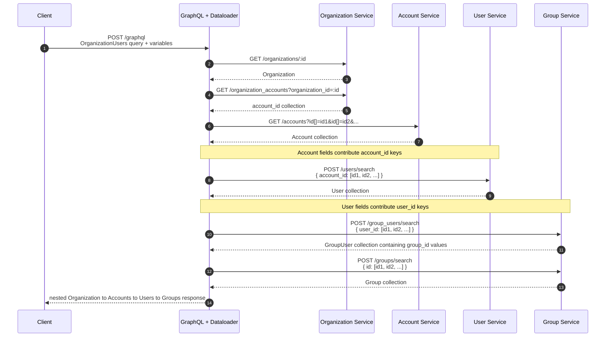
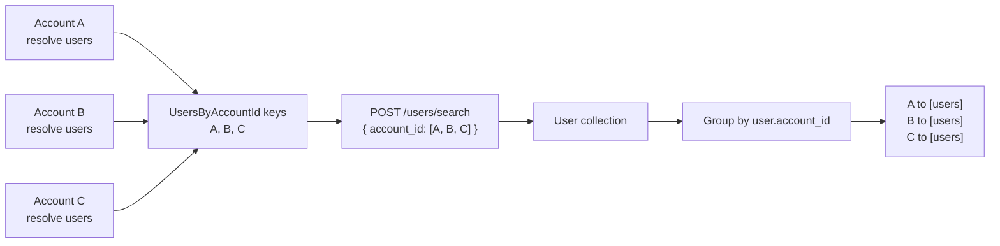
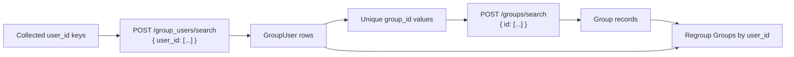

# GraphQL Auth Explosion Case Study, Part 6: GraphQL and Dataloader

Series: [GraphQL Auth Explosion Case Study](/articles/series/IAM-System-Demo/iam-system-demo)  
Overview: [GraphQL Auth Explosion Case Study](/articles/series/IAM-System-Demo/graphql-auth-explosion-case-study)

> Status: waiting on Dataloader consistency audit; [trace evidence is available](./graphql-auth-explosion-traces#graphql-preserves-the-service-boundaries).

LLM Disclaimer:
LLM's were used in the preperation of this series of articles. For the most part I try to call out per-article if it is particularly LLM heavy, but for the most part I'm trying to keep it human-written and avoid triggering people.

## GraphQL Is Where the N+1 Comes Back

Everything up to this point can be implemented through REST APIs. Those APIs now accept collections: multiple Account IDs, multiple User `account_id` join keys, and multiple GroupUser `user_id` join keys.

GraphQL puts a convenient object graph over those service boundaries. That is useful, but it creates exactly the abstraction that made the original problem dangerous: field resolvers make remote records look local again. Dataloader is the mechanism that preserves the collection-shaped REST calls underneath that object graph.

It does not do that automatically. A Dataloader source receives a collection of keys; its implementation must actually make a collection-shaped downstream request. A source that loops over its keys is still an N+1.

## The Query We Need to Make Cheap

This is the organization-wide query used by the demo's wide-organization fixture. One client request asks for every Account, every User belonging to those Accounts, and every Group belonging to those Users:

```graphql
query OrganizationUsers($organizationId: ID!, $as: ID!) {
  organization(id: $organizationId, as: $as) {
    id
    name
    accounts {
      id
      name
      users {
        id
        email
        accountId
        groups {
          id
          name
        }
      }
    }
  }
}
```

```json
{
  "organizationId": "<wide-organization fixture ID>",
  "as": "<that organization's top-level administrator ID>"
}
```

The query looks like a tree because that is the response shape the client wants. It is not the order in which the services can retrieve the data:



The Group lookup is necessarily a second stage. The system does not know which Group records to request until the GroupUser response supplies their IDs.

## What Naïve Field Resolution Would Do

Without key collection, resolving the nested fields reproduces the cross-network N+1 at each level. The following diagram shows request shape, not authorization traffic; each downstream service still performs the authorization required for the records it returns.



This is why “we use GraphQL” is not a performance strategy. GraphQL supplies a place to express nested work. Without a batching implementation, it becomes a very polite distributed N+1 generator.

## What Dataloader Actually Changes

When every collection fits within the configured batch size, the same logical field resolutions can become the following downstream data requests. Larger collections are split into `ceil(key count / batch size)` requests per stage; they must never fall back to one request per record.



The number of GraphQL field resolutions has not changed. The number and shape of network requests has. Dataloader waits until it has the keys requested for a source, calls that source once for the collected keys, and requires the source to return one result for each key in the original order.

## Collect, Fetch, Regroup

`UsersByAccountId` demonstrates the essential transformation. Many Account objects independently resolve their `users` field, but they share one source instance for the same actor and request context:



The regrouping step is part of the contract. Returning one flat collection is not enough: Dataloader must associate each Account key with exactly the Users that belong to it, including an empty array when an Account has none.

`GroupsByUserId` performs the same operation with a dependency in the middle:



That requires two batched stages, not one Group request. Showing both stages keeps the remaining request cardinality visible: traces should contain the GroupUser request followed by the Group request.

## Dataloader Preserves the Work Done Earlier

The Dataloader layer is effective only because the lower layers already expose collection-shaped operations. It can collect Account IDs, but Account Service must accept multiple IDs. It can collect account join keys, but User Service must accept multiple `account_id` values. It can collect User IDs, but Group Service must accept multiple `user_id` values.

The implementation still has to preserve the actor identity, authorization semantics, ordering, missing-record policy, chunk boundaries, and trace context through every source. Those details are under audit before this page is ready for publication. The lesson does not depend on pretending they are already perfect:

> Dataloader creates an opportunity to batch. Only the source implementation decides whether that opportunity survives the next network boundary.


## Measured Evidence

The [MSP scale results](./graphql-auth-explosion-results#graphql-msp-scale) report complete paginated walks, and the [batch-boundary comparison](./graphql-auth-explosion-results#batch-boundaries) compares sizes 200, 1000, and 10000. [Explore the selected GraphQL traces](./graphql-auth-explosion-traces#graphql-preserves-the-service-boundaries), including one warm MSP page; a page trace is not the full walk.
