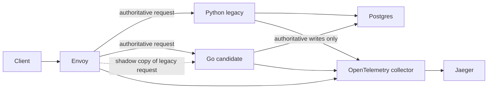

# Replacing a Python Service with Go, One Request at a Time

A rewrite can return the same JSON and still do the wrong thing. A read might come from stale data. A write might happen twice. A shadow request might quietly mutate the database. Those are the failure modes I wanted to make visible in my [strangler fig demo](https://github.com/meleneth/strangler-fig-demo): a small Python service, a Go replacement, and a gateway that can move traffic between them while checking the effects of each step.

The application is intentionally small. Both services expose `GET /items` and `POST /items` against one Postgres table. That makes the migration mechanism, rather than business complexity, the thing to study. The generated project is self-contained: after generation, its Compose files, applications, scripts, and verifier run without the generator.

## Put the decision at the edge

Envoy selects the authoritative service using weighted clusters. A second, independent runtime setting controls what fraction of requests served by Python are also mirrored to Go. The client receives only the authoritative response. Envoy discards the mirror response. Candidate-authoritative requests are not mirrored back to candidate.

The gateway removes caller-supplied `X-Mobilis-Shadow` and mirror-target headers. Only its mirrored copy gets the shadow marker; backend HTTP ports are not published to the host. This is a trust boundary for the local Compose network, not a general authentication design. The [Envoy route](https://github.com/meleneth/strangler-fig-demo/blob/main/gateway/envoy.yaml) defines both the routing weights and the mirror policy.

## The candidate computes before it decides to commit

The Go handler parses and validates an item, then constructs an insert effect from the accepted values. It uses that same effect for the database operation and for telemetry. The shadow marker changes only the final commitment step: a mirrored request records its intended insert and skips the database call; an authoritative request commits and records the applied effect. There is no separate shadow implementation of the business rule in [the Go handler](https://github.com/meleneth/strangler-fig-demo/blob/main/candidate/internal/app/routes.go).

That distinction matters for writes. Sending two ordinary writes to a shared database would create duplicate effects, while comparing only the two HTTP responses would miss that error. Here the verifier checks a fresh insert against three kinds of evidence: the response, the Postgres row and audit record, and the traced semantic effect. At full mirroring, it also compares the candidate's shadow intent to the authoritative effect and confirms that the shadow made no item database call.

The services share a deliberately narrow contract: valid `POST /items` requests contain exactly an integer `id` and a constrained string `name`; invalid requests return `400`, and duplicate IDs or names return `409` on authoritative writes. A shadow request does not check uniqueness, because Python may have committed the same insert by the time its mirror arrives. The demo therefore makes no claim that shadow conflict responses are equivalent.

## Move authority in measured steps

Running `./demo` starts the selected Compose environment, resets the demo table, and executes this progression. The two numbers passed to `./migration` are **mirror percentage** and **candidate authority percentage**, in that order.

| Stage | Command | What it exercises |
| --- | --- | --- |
| Observe | `./migration 100 0` | Python serves every response; every eligible request is mirrored to Go. |
| Small cutover | `./migration 100 10` | Go serves about 10% of public requests; Python requests are still mirrored. |
| Wider cutover | `./migration 100 50` | Both implementations serve authoritative requests. |
| Complete cutover | `./migration 0 100` | Go serves everything, with no mirrors. |

Each stage runs `./exercise` and `./verify`. The exercise performs a health check, reads items, writes through the gateway, and reads again. The verifier makes its own correlated requests and examines the actual running services. The public weighted split is random; an internal verification listener walks all 100 selection buckets so the authority check does not depend on a lucky sample. The runtime settings are in memory, so restarting Envoy requires reapplying `./migration`.

The outage checks are useful too. At `100/0`, the verifier stops the Go candidate and confirms that Python still serves reads and writes, then restores the same candidate deployment and verifies mirroring again. At `0/100`, it stops the legacy HTTP server while checking Go. These are direct checks of the two endpoints of the rollout, rather than an assumption that the route configuration implies availability.

## What the evidence can and cannot say

The [verifier](https://github.com/meleneth/strangler-fig-demo/blob/main/legacy/demo/operations.py) gives each request a trace ID, retrieves its spans from Jaeger, and checks that gateway, backend, item query, and effect spans have the expected ancestry. It independently reads Postgres and its write audit. It also tests malformed inputs, duplicate writes, and attempts to spoof the shadow header. A passing `./verify` means these particular read, write, routing, and trace contracts held for the local workload.

It does not prove equivalence for arbitrary application behavior. The demo has one table, deterministic insert intent, no updates or deletes, no external side effects, and no concurrent migration controller. Shadow mode does not model database constraints or contention. Telemetry includes item values, which would need careful handling for sensitive data. The point of the exercise is the discipline: transfer authority only after the candidate's observed behavior and effects are good enough for the workload being moved.

The complete source and instructions are in [meleneth/strangler-fig-demo](https://github.com/meleneth/strangler-fig-demo). Start with its `README.md`, then inspect `gateway/envoy.yaml`, the two item handlers, and `legacy/demo/operations.py` to see how the routing and evidence fit together.
